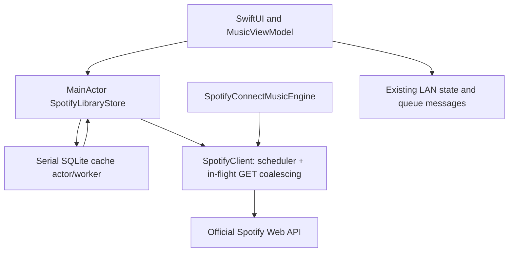

# Spotify: Swift SQLite cache and playback latency plan

Status: P0–P5 implemented locally on 2026-11-02 after owner authorization; automated verification complete, changes uncommitted and unreleased. Measurements and manual verification limits are recorded in Section 13.
Created: 2026-11-01, Europe/Moscow.
Owner decision: use SQLite with Swift, and plan the library/request/playback optimizations discussed on 2026-11-01. The initial task produced the plan only; the owner requested its implementation on 2026-11-02.

The intended result is immediate browsing of previously loaded music, useful content before a full library refresh finishes, fewer Spotify requests, and faster Resume/Next/Previous/Add-to-Queue without losing confirmed playback state or queue correctness. Spotify remains the authority for account data and actual playback. SQLite is a disposable, bounded metadata cache.

## 1. Scope and architectural principles

- Keep SwiftUI, Swift 6 complete concurrency checking, the existing `MusicCore` models, official Spotify Connect playback, and the encrypted LAN remote.
- Implement a small Mac-only persistence service using the system `SQLite3` module (`libsqlite3`); no external database framework, server, or Rust layer is required.
- Keep a **single caching authority** for library metadata: `SpotifyLibraryStore` backed by SQLite (plus a small 60-second in-memory cache for exact search queries). Do not add a second raw HTTP response cache in `SpotifyClient`.
- Reuse embedded album tracks already returned by Spotify's `GET /v1/me/albums` and `GET /v1/albums/{id}` (`SpotifyAlbum.tracks`) instead of re-fetching `/albums/{id}/tracks` for albums with ≤ 50 tracks. Drop speculative background prefetching.
- Model the Connect helper playlist around the full queue timeline (`queue.history + queue.items` with `cursor = queue.history.count`). Use offset jumps (`PUT /v1/me/player/play` at `offset: cursor`) with zero playlist writes only while the complete occurrence order is unchanged and fresh helper metadata validates the stored mapping; otherwise rebuild the mirror.
- Optimize `addToQueue` as a single positional insert (`POST /v1/playlists/{id}/items` at `history.count + manual.count`, after `current` and before `source`) without pausing active playback; keep conservative full-playlist replacement (`mirror`) for `remove`, `move`, and `setShuffle`.
- **Eliminate continuous periodic polling (`GET /v1/me/player` every 2 s / 10 s)**: advance playback progress locally on Mac via a monotonic clock, run **zero** background requests while paused, and schedule only a single one-shot track-boundary check (`duration - position`) per playing song (plus optional local macOS `DistributedNotificationCenter` `"com.spotify.client.PlaybackStateChanged"` / app-activation observation).
- Preserve the current favorites contract, duplicate occurrences, unavailable playlist positions, confirmed pause before switching video/music, restrictions, and helper-playlist ownership/privacy checks.
- Keep artwork and a new playback engine outside this task. Use existing approved loading/recovery surfaces; any new visible states must be designed on Figma page 08 before implementation, following AGENTS.md §3.5.

The working tree already contains unrelated changes and the completed stale-poll fix. Preserve them. Related evidence: [stale-poll investigation](<DONE/DONE - 2026-11-01_15-44_Spotify-stale-poll.md>), [Music verification](../runbooks/MUSIC-VERIFICATION.md), and [connection/consent follow-up](<DONE/DONE - 2026-11-01_11-55_Spotify-interface-and-consent.md>).

## 2. Confirmed findings and reproduction

These are structural findings from source inspection, not measured claims about current API latency.

| Finding | Evidence in the current code | Consequence |
|---|---|---|
| Library, catalogue, playlist index and loaded-album IDs live only in memory | `PlayerMac/PlayerMac/Music/Spotify/SpotifyLibraryStore.swift`, `PlaylistMembershipIndex.swift` | Restart loses useful metadata and completeness information |
| Connection fetches the profile; library refresh fetches it again | `SpotifyAccount.begin`, `SpotifyLibraryStore.refresh` | Duplicate `/v1/me` request during connection |
| `savedAlbums()` and `album(_:)` already decode `SpotifyAlbum.tracks`, but `SpotifyLibraryStore` discards it | `SpotifyModels.swift`, `SpotifyLibraryStore.refresh`, `loadAlbum` | Every album click makes 2 HTTP requests (`album` + `albumTracks`) even when ≤ 50 tracks were already returned in `savedAlbums()` or `album(_:)` |
| Liked tracks, albums, artists, playlist pages and changed playlist contents are awaited sequentially before any UI publication | `SpotifyLibraryStore.refresh`, `MusicViewModel+Library.syncLibrary` | Large `likedTracks` or slow background playlists delay the default Albums screen |
| Global `isLoading` blocks all favorite and playlist mutations during refresh | `MusicViewModel.swift`, `RemoteMusicBridge.swift` | Background revalidation disables likes, album saves, and remote favorite actions even when cached data is visible |
| Catalogue merges, album track lookup, playlist resolution, and remote lookups use `O(N²)` linear array scans | `SpotifyLibraryStore.merge`, `MusicCatalog.tracks(in:)`, `BrowserSelection.contents`, `RemoteMusicBridge.swift` | Repeated `first(where:)` / `firstIndex(where:)` scans across thousands of tracks on MainActor |
| Albums have a memory-only `loadedAlbums` set; artists/search have no freshness or in-flight sharing | `loadAlbum`, `loadArtist`, `search` | Repeated navigation repeats requests; no ETag revalidation |
| `Resume` calls `startQueue`, which runs the full engine `play` path | `MusicViewModel+Playback.setPaused`, `startQueue` | Continuing a paused track rewrites the helper playlist instead of calling `musicEngine.setPaused(false)` |
| `Next` and `Previous` call `startQueue` because `mirrored` omits `queue.history` | `advance`, `previous`, `SpotifyConnectMusicEngine.play` | Every track skip runs 9–11 HTTP calls (devices, playback, pause, confirm, playlist check, replace items, shuffle, repeat, play, confirm) |
| `updateQueue` while playing calls `play(queue:position:)`, and `addToQueue` inserts into `manual` before `source` | `MusicQueue.add`, `SpotifyConnectMusicEngine.updateQueue` | Adding one track to the queue while playing pauses audio, rewrites the helper playlist, and restarts the current track |
| Full `play` always calls `/devices`, `shuffle(false)`, and `repeatMode(...)` even when `/me/player` already reports matching state | `selectDevice`, `play` | 3–4 avoidable serial round-trips before `PUT /me/player/play` |
| Confirmation shares the 2-second interval used by normal playing-state polling | `confirm`, `pollInterval` | A command that settles 150 ms after the first check waits a full 2 seconds for the second check |
| Continuous polling runs every 2 s while playing (1,800 req/h) and every 10 s while paused (360 req/h) | `SpotifyConnectMusicEngine+State.beginPolling` | Rapidly exhausts Spotify Development Mode quota even during light or idle use |
| Seeking within 0.2 s of track end can fail confirmation when playback naturally advances | `SpotifyConnectMusicEngine.seek` | Boundary seeks can report `unconfirmed` after track transition |
| A stale-poll generation guard is already present | `commandGeneration`, `beginPolling` | All fast paths and one-shot boundary checks must retain its success and failure protection |

Reproduction/measurement scenarios for the implementation phase:

1. Load a synthetic library, close/recreate its store, and open the same saved album with HTTP responses held behind a test gate. Verify immediate local restoration without network calls.
2. Hold `likedTracks` and playlist item pages while returning `savedAlbums` (with embedded `tracks`) immediately. Record when the default Albums screen and its first album's tracks become browsable and playable.
3. Start a queue, pause, then Resume; press Next and Previous; add a track to the queue while playing. Record the exact HTTP endpoint sequence and helper playlist write count.
4. Return the old playback state for the first post-command observation and the updated state 150 ms later. Measure confirmation time with fast backoff vs the 2-second poll interval.
5. Repeat identical album/artist/search loads concurrently, inject 429, mutate favorites during background refresh, and disconnect while responses are held.

Live Spotify latency, storage size on real libraries, and the proportion of delay caused by the API remain unmeasured until P0 baseline runs.

## 3. Data flow and ownership



- `SpotifyLibraryStore` remains `@MainActor` and owns the published `LibrarySnapshot`, `MusicCatalog`, `PlaylistMembershipIndex`, and a monotonic `mutationRevision: UInt64`.
- Network pagination, JSON decoding, and SQLite I/O run off `@MainActor`. The SQLite connection belongs to a dedicated serial actor (`SpotifyCacheStore`) exposing typed async methods—never raw `OpaquePointer` handles or arbitrary SQL closures.
- Separate `isInitialLoading` (cold start with an empty store) from `isRefreshing` (background synchronization over cached or partially published data). `isRefreshing` never blocks browsing or independent favorite mutations.
- Every connection session has a `sessionGeneration: UUID`. Delayed network or cache results from a retired session are discarded before touching `@MainActor` state or SQLite.

## 4. SQLite design

### 4.1 Location, connection, and failure behavior

- Store the database in the user's Caches directory: `<bundle-id>/Spotify/v1/<opaque-account-namespace>/library.sqlite`, resolved via `FileManager`.
- Derive `<opaque-account-namespace>` from a SHA-256 digest of `clientID + ":" + verifiedUserID`. Verify the stored `(clientID, userID)` row on open.
- Exclude the cache directory from backups (`isExcludedFromBackup = true`). Never store bearer tokens, refresh tokens, authorization headers, or search queries on disk.
- Use one serial SQLite connection with `SQLITE_OPEN_READWRITE | SQLITE_OPEN_CREATE | SQLITE_OPEN_FULLMUTEX`, `PRAGMA foreign_keys = ON`, `PRAGMA busy_timeout = 2000`, and `PRAGMA synchronous = NORMAL`.
- Version schema with `PRAGMA user_version`. Migrations run inside an explicit transaction. If a database has an unknown newer `user_version` or fails integrity/migration checks, recreate only that app-owned `library.sqlite` file (or fall back to memory-only operation if disk I/O fails) without blocking video or Spotify playback.
- **No disk staging tables**: accumulate paginated network responses in memory inside the fetching task and commit each completed resource to SQLite in a single short `BEGIN IMMEDIATE ... COMMIT` transaction. Never hold a SQLite transaction across an `await`. Cancelled or failed network fetches automatically discard their in-memory pages without touching disk.

### 4.2 Compact 5-table schema

Because `MusicTrack`, `MusicAlbum`, and `MusicPlaylist` already encapsulate their artist lists and ordered `trackIDs` (including `"unavailable:\(offset)"` placeholders), avoid over-normalized join tables (`entity_artists`, `album_items`, `playlist_items`) and staging tables. Use five compact tables:

| Table | Columns | Purpose |
|---|---|---|
| `account_meta` | `namespace TEXT PRIMARY KEY, client_id TEXT, user_id TEXT, display_name TEXT, updated_at REAL` | Verify account ownership and restore display name on launch |
| `resource_state` | `key TEXT PRIMARY KEY, etag TEXT, snapshot_id TEXT, is_complete INTEGER, fetched_at REAL, expires_at REAL` | Track freshness, completeness, and validators for `"liked"`, `"albums"`, `"artists"`, `"playlists"`, `"album:<id>"`, `"artist:<id>"`, `"playlist:<id>"` |
| `library_lists` | `kind TEXT PRIMARY KEY, ids_json BLOB, updated_at REAL` | Ordered IDs for `"liked"`, `"albums"`, and `"artists"` |
| `playlists` | `id TEXT PRIMARY KEY, owner_id TEXT, collaborative INTEGER, title TEXT, uri TEXT, snapshot_id TEXT, track_ids_json BLOB, is_complete INTEGER, updated_at REAL` | Playlist metadata and complete ordered `trackIDs` occurrences |
| `catalog_entities` | `kind TEXT, id TEXT, payload_json BLOB, updated_at REAL, PRIMARY KEY (kind, id)` | Encoded `MusicTrack`, `MusicAlbum` (with `trackIDs`), and `MusicArtist` values |

**In-memory `O(1)` lookup in `MusicCatalog`**:
Add internal dictionary indices (`tracksByID: [String: Int]`, `albumsByID: [String: Int]`, `artistsByID: [String: Int]`, or direct `O(1)` lookup helpers `track(id:)`, `album(id:)`, `artist(id:)`) to `MusicCatalog`. This eliminates all `O(N²)` linear scans in `SpotifyLibraryStore.merge`, `MusicCatalog.tracks(in:)`, `BrowserSelection.contents`, and `RemoteMusicBridge` without complex view-level caching. Keep `MusicViewModel.sortedAlbums` memoized by `(albumIDs, sortAlbumsByArtist)`.

### 4.3 Freshness and retention

These are product defaults for stale-while-revalidate; Spotify's [Developer Terms](https://developer.spotify.com/terms#section-iv-restrictions) permit temporary caching for performance and require deletion on disconnect.

| Resource | Soft freshness (serve without revalidation) | Hard retention (evict if unvalidated) |
|---|---|---|
| Liked tracks, saved albums, followed artists, playlist summaries | 5 minutes | 7 days |
| Playlist items (`playlist:<id>`) | Valid while `snapshot_id` matches the latest playlist summary | 7 days; invalidated on local mutation or changed `snapshot_id` |
| Album metadata & tracks (`album:<id>`) | 24 hours when `is_complete == 1` | 7 days |
| Artist albums (`artist:<id>`) | 1 hour | 7 days |
| Search responses | 60 seconds in bounded RAM (max 20 queries); never written to SQLite | Session only; cleared on disconnect or account change |
| Playback, restrictions, devices | Live only; never cached | Session only |

Cap the SQLite file at 100 MiB. On open, delete rows whose `updated_at` exceeds the 7-day hard limit and prune unreferenced `catalog_entities` not present in any `library_lists`, `playlists`, or saved album. Never partially evict tracks from a complete playlist or album.

### 4.4 Restore, account changes, and disconnect

1. Persist the last verified account binding `(clientID, userID, accountName)` in `UserDefaults` only after `/v1/me` succeeds and current terms (`SpotifyDocuments.currentVersion`) are accepted.
2. On ordinary relaunch with valid consent and a stored refresh credential, immediately open the matching `SpotifyCacheStore` namespace and populate `SpotifyLibraryStore` from SQLite before OAuth token refresh completes. Playback and mutation commands wait for connection or remain disabled until `SpotifyAccount` finishes connecting.
3. Pass the `SpotifyProfile` already fetched in `SpotifyAccount.begin` directly to `onConnected(client, profile)` and `SpotifyLibraryStore(client:profile:)`, eliminating the duplicate `/v1/me` call during `refresh()`.
4. During interactive login or Client ID change, do not display a previous account's cache. If the verified `profile.id` differs from the previous namespace, switch to the new namespace cleanly.
5. In `SpotifyAccount.disconnect()`, await `beforeDisconnect?()` so playback settles, cancel library sync tasks, close the `SpotifyClient`, await `SpotifyCacheStore.destroyAccountCache()` (which closes SQLite and deletes the `<opaque-account-namespace>` directory, including `.sqlite`, `-journal`, `-wal`, and `-shm` files), and clear stored account/queue preferences before `finishDisconnect()` completes.

## 5. Library synchronization, embedded album tracks, and mutations

### 5.1 Embedded album tracks and three-wave progressive sync

1. **Extract embedded tracks from `SpotifyAlbum`**:
   - Both `GET /v1/me/albums` and `GET /v1/albums/{id}` include `tracks: SpotifyPage<SpotifyTrack>?` (up to 50 tracks).
   - Update `SpotifyAlbum` mapping so that when `album.tracks` is present, its items are converted via `SpotifyTrack.model(album: album)` and merged into `catalog.tracks`.
   - When `album.tracks?.next == nil` (all albums with ≤ 50 tracks), set `album.trackIDs` immediately and mark `"album:<id>"` complete!
   - In `loadAlbum(_ id: String)`, if the album is already complete in memory or SQLite (and not expired), return immediately with **zero HTTP requests**. If an album has `tracks?.next != nil` (> 50 tracks), fetch only the remaining pages starting from `tracks.next` instead of re-fetching page 1.
2. **Three-wave progressive `refresh()`**:
   - **Wave 0 (Disk restore)**: Load cached `LibrarySnapshot`, `MusicCatalog`, and `PlaylistMembershipIndex` from SQLite immediately upon store initialization and publish to `MusicViewModel`.
   - **Wave 1 (Primary visible screen)**: Concurrently fetch `savedAlbums()` and `playlists()` summaries (2 requests). Because `savedAlbums()` embeds tracks for ≤ 50-track albums, publish `savedAlbumIDs`, `playlists` summaries, and embedded album tracks immediately! If the currently selected album has > 50 tracks (`!isComplete`), load its remaining pages now. The default **All Albums** screen and playlist navigation are available; playlist contents and membership actions still require the per-resource loading checks below. An unloaded playlist is not an empty playlist.
   - **Wave 2 (Library collections)**: Fetch `likedTracks()` and `followedArtists()` through the request scheduler. As each completes all of its pages in memory, merge into `catalog`/`library`, persist to SQLite in one transaction, and publish on `@MainActor`.
   - **Wave 3 (Changed playlist memberships)**: For editable playlists whose `snapshotID` is not already complete in `PlaylistMembershipIndex` / SQLite, fetch `playlistItems(id)` sequentially through the background scheduler, updating `index`, `library.playlists`, and SQLite as each playlist finishes.

### 5.2 Mutations and refresh coordination

- **Unblock independent mutations during background refresh**:
  - Replace the global `!isLoading` guard with connection, `!isInitialLoading`, and `!isMutating` checks plus readiness checks for the resources the operation reads. Acquire the mutation slot before awaiting readiness; compute the policy and its Undo from the resulting store snapshot, not from the earlier UI snapshot. Apply the same path to Mac and LAN actions, retries, and Undo.
  - `trackLiked(true)`, `albumSaved`, `artistFollowed`, and `createPlaylist` do not require every playlist's items. Like/save/follow policy and toggles still require the relevant library collection to be complete; unfinished Wave 2 data must not be interpreted as an empty collection.
  - Before computing `FavoritesPolicy.membership(...)` for either inclusion or removal, call `store.ensurePlaylistLoaded(playlistID)`. Validate editability and the current remote snapshot; reuse complete ordered `trackIDs` only if that snapshot matches, otherwise await all item pages. Preserve duplicate occurrences and unavailable positions. Recheck the snapshot after pagination; if it changed, discard the inconsistent pages and retry within a bounded attempt budget or report a recoverable failure. No mutation is sent on loading failure or an incomplete resource.
  - **Unliking a track (`trackLiked(id, false)`)** inspects all `library.editablePlaylists` to remove occurrences. Before computing `FavoritesPolicy.track(id, liked: false, in: library)`, call `store.ensureEditablePlaylistsLoaded()`: obtain a complete current editable-playlist list, then apply the same snapshot/completeness checks to each playlist. Share in-flight loads with Wave 3 rather than duplicating them.
  - Before **Undo**, ensure every affected playlist is complete and current (all affected playlists for an unlike Undo). Retain the confirmed post-mutation snapshots with the Undo record. If a playlist has changed since that action, do not replay its saved positional inserts blindly; retain the refreshed data and report a recoverable conflict unless the original occurrence positions can be verified. Loading alone does not make old Undo positions valid.
- **Prevent stale background sync from overwriting a mutation**:
  - Maintain `mutationRevision: UInt64` and the last changed revision per resource key on `SpotifyLibraryStore`. Each fetch captures its session and resource revisions before its first request; track resources with an in-flight mutation or unsettled compensation as well.
  - Each confirmed `store.apply(mutations)` or `store.createPlaylist(...)` increments the revision, updates `library` and `PlaylistMembershipIndex` on `@MainActor`, and persists the confirmed resource state to SQLite. A playlist edit affects `playlist:<id>` and its summary snapshot in `playlists`; creation also affects the playlist list. Keep completeness and remote freshness separate: confirmed contents remain available while marked for revalidation.
  - When a background response conflicts with a changed revision or an in-flight mutation, retain the latest confirmed local state of each affected resource and discard that response's conflicting portion. Publish unrelated resources normally. **Never replay positional mutations over a fetched snapshot**: it may already contain the write, so applying `.playlistInsert(X, [1])` to `[A, X, B]` would produce `[A, X, X, B]`. Do not deduplicate by track ID either; duplicate occurrences are valid.
  - After the mutation/compensation settles, coalesce a fresh revalidation of each affected resource, starting after that settlement. Advance affected resource revisions on compensated failures too, retiring fetches that may have observed intermediate writes. Publish revalidation only if its session and resource revisions still match and its pagination/snapshot checks pass. Serialize publication and SQLite persistence with mutation commits so an older fetch cannot overwrite newer memory or disk state. Revalidation failures retain confirmed data as stale and use the existing retry/cooldown behavior.
  - Retain `FavoritesService.apply([], to: library)` at the start of `refresh()` and before new mutations so pending rollback compensation from a prior partial failure is settled first, through the same serialized mutation boundary. Revalidate compensated resources before computing a new policy.
  - If a Spotify mutation succeeds but SQLite persistence fails, keep the confirmed in-memory state and log/mark cache state stale; never roll back a succeeded Spotify write because of a local disk error.

### 5.3 Repeated navigation and search

- Coalesce concurrent `loadAlbum(id)` and `loadArtist(id)` calls in `SpotifyLibraryStore` by resource key so rapid selection changes or `playAlbum` shares an in-flight task rather than issuing duplicate GETs.
- Do not add speculative album prefetching: `savedAlbums()` already provides the tracks for ≤ 50-track saved albums, and on-demand `loadAlbum` requires at most 1 request for non-saved albums.
- Keep the existing 300 ms debounce in `MusicViewModel.searchSpotify()`. Add a bounded in-memory search cache (up to 20 normalized queries, 60-second TTL, cleared on disconnect) and preserve previous search results while re-running the same query.

## 6. HTTP request scheduling, coalescing, and conditional GETs

Extend `SpotifyClient` while keeping its single `URLSession`, token refresh coalescing, redirect rejection, pagination origin checks, and shutdown drain:

1. **Priority scheduler with bounded concurrency**:
   - **Control priority**: Playback commands (`/v1/me/player*`, helper playlist validation and writes, `/v1/me/devices`) and post-command confirmations. Always admitted first; never starved by library sync.
   - **Interactive priority**: On-demand `loadAlbum`, `loadArtist`, `search`, and user favorite/playlist mutations.
   - **Background priority**: Wave 2/3 library refresh pages.
   - Limit concurrent requests to **3 total in flight, at most 2 non-control requests**, always reserving 1 slot for control commands.
2. **In-flight GET coalescing**:
   - Coalesce identical concurrent cacheable `GET` requests (matching path + canonical query + resource revision) while in flight so simultaneous callers await the same network task. Post-mutation revalidation must not join a fetch started before the mutation settled. Never coalesce `/v1/me/player*`, live helper validation, or `POST`/`PUT`/`DELETE` requests.
3. **Lightweight conditional GET (`ETag` / `304 Not Modified`)**:
   - Instead of a second 16 MiB raw HTTP response cache in `SpotifyClient`, pass the stored `etag` from `resource_state` (`If-None-Match`) when revalidating single-resource or first-page endpoints that provide an `ETag`. On HTTP `304`, `SpotifyLibraryStore` simply bumps `fetched_at` and `expires_at` in SQLite and reuses its existing typed models.
4. **Shared `Retry-After` cooldown**:
   - Preserve the shared `cooldown` on HTTP `429` ([Spotify rate limits](https://developer.spotify.com/documentation/web-api/concepts/rate-limits)). Queued requests re-check `cooldown` immediately upon acquiring a scheduler slot so a `429` from one request blocks subsequent queued requests from dispatching during the pause window.

## 7. Playback and queue latency optimization

### 7.1 Full-timeline mirroring (`queue.history + queue.items`)

Currently, `SpotifyConnectMusicEngine` stores `mirrored = queue.items` (`[current] + upcoming`) and omits `queue.history`. Use the full ordered occurrence timeline as a candidate for reuse:

```swift
let timeline = queue.history + queue.items // current is at index queue.history.count
```

Ordinary `next()` without repeat-wrap preserves this order, but `previous()` does not always preserve it: with history `[A]`, current `B` from the source, manual `[X]`, and source `[C]`, it changes `[A, B, X, C]` into `[A, X, B, C]`. Repeat-all wrap also creates new occurrence UUIDs. Compare the complete ordered occurrence IDs after every transition; reuse offsets only when the order matches exactly, otherwise rebuild. Keep the existing manual-before-source queue semantics.

Update `SpotifyConnectMusicEngine` to track:
- `mirrored: [MusicQueueItem]` — the full mirrored timeline (`queue.history + queue.items`)
- `cursor: Int` — the index of `queue.current` in `mirrored` (`queue.history.count`)
- `mirroredSnapshotID: String?` — the helper playlist `snapshot_id` from the final successful write of the complete mirror (or a successful incremental insertion); invalidate the mapping after partial write failure

### 7.2 Fast paths for Resume, Next, Previous, and Cold Play

**Validate the helper before reusing its occurrence mapping.** For each warm command, fetch live `GET /v1/playlists/{id}` and require the existing ownership/privacy predicate (`owner.id == userID`, `public != true`, `collaborative != true`) plus a non-empty `snapshot_id` equal to `mirroredSnapshotID`. A matching device and `context.uri` alone cannot detect reordered items or changed visibility. Check privacy independently even when the snapshot matches. Spotify exposes the version and visibility in [Get Playlist](https://developer.spotify.com/documentation/web-api/reference/get-playlist); playback [offsets address positions within the context](https://developer.spotify.com/documentation/web-api/reference/start-a-users-playback).

On a snapshot mismatch, invalidate the stored offsets and use the full rebuild path. On missing helper or changed ownership/privacy, use the existing `ensurePlaylist()` recovery: leave an unsuitable playlist intact and create a new private helper. A missing validator or failed validation never authorizes a warm jump; rebuild safely or return the existing recoverable error. This GET must bypass library-cache freshness and run at control priority. Keep fresh playback restrictions, expected shuffle/repeat settings, command-generation guards, and post-command confirmation; the metadata check and playback request are not an atomic transaction against external edits.

| User action | Condition for warm fast path | Executed HTTP requests |
|---|---|---|
| **Resume** (`setPaused(false)`) | `deviceID != nil`, `playlistID != nil`, `mirrored.map(\.id) == timeline.map(\.id)`, `cursor == queue.history.count`, fresh `GET /me/player` matches `deviceID`, helper `context.uri`, and current track URI, and live helper validation above succeeds | 1. `GET /v1/me/player`<br>2. `GET /v1/playlists/{id}`<br>3. `PUT /v1/me/player/play` (no body, if paused)<br>4. Fast confirmation |
| **Next / Previous** (`advance`, `previous`) | `deviceID != nil`, `playlistID != nil`, `mirrored.map(\.id) == timeline.map(\.id)`, fresh `GET /me/player` matches `deviceID` and helper `context.uri`, and live helper validation above succeeds | 1. `GET /v1/me/player`<br>2. `GET /v1/playlists/{id}`<br>3. `PUT /v1/me/player/play` with `context_uri`, `offset: queue.history.count`, `position_ms: 0`<br>4. Fast confirmation (**0 playlist writes**) |
| **Cold Play / Rebuilt Queue** | New queue, changed occurrence order (including Previous across pending manual items), wrap-around, or mismatched context/device/helper snapshot | 1. `GET /v1/me/player` (reuse `state.device.id` if it is our unrestricted local `Computer`; call `/devices` only if not)<br>2. Pause only if `state.isPlaying` on the helper context being replaced<br>3. `ensurePlaylist()` + `mirror(timeline)`<br>4. Call `shuffle(false)` / `repeatMode(...)` **only** if `state` did not already match<br>5. `PUT /v1/me/player/play` at `offset: queue.history.count, position_ms: Int(position * 1000)`<br>6. Fast confirmation |

In `MusicViewModel+Playback.swift`:
- `setPaused(false)`: if `musicEngine` has already mirrored the current queue (`queue == confirmed/mirrored`), call `musicEngine.setPaused(false)`. The engine revalidates the live context and helper before resuming; an invalid mapping falls back to `play(queue:position:)` for rebuilding or reports the existing recovery error.
- `advance` and `previous`: call `startQueue(next)`, which invokes `musicEngine.play(queue: next, position: 0)`. Inside `SpotifyConnectMusicEngine.play(queue:position:)`, require exact full occurrence-order equality, `validateContext(state)` on our local device, and live helper snapshot/ownership/privacy validation. Only then execute the **Warm Offset Jump** (`PUT /v1/me/player/play` at `offset: queue.history.count`), skipping `/devices`, item writes, `/shuffle`, and `/repeat` when the observed settings already match. The helper metadata GET remains required.

### 7.3 Safe, minimal queue edits (`updateQueue`)

In `MusicQueue`, `upcoming` is `manual + source`, and `add(_ track:)` appends to `manual`—meaning a newly queued track is inserted at index `insertIndex = queue.history.count + queue.manual.count` (strictly after `current`, before `source`), **not** at the end of the playlist when `source` is non-empty.

Keep `updateQueue(_ queue:position:paused:)` simple and immune to duplicate-URI deletion hazards:

1. **Repeat-only change** (`timeline.map(\.id) == mirrored.map(\.id)`): keep the existing 1-request `PUT /v1/me/player/repeat` path.
2. **Single/contiguous insertion after `cursor` (`addToQueue`)**:
   - When `timeline` equals `mirrored` with `k` (`1 <= k <= 100`) new items inserted at `insertIndex > cursor` (and `playlistID != nil`):
   - Validate helper ownership/privacy and check that `playlist.snapshotID == mirroredSnapshotID`.
   - Call `POST /v1/playlists/{id}/items` (`insertItems`) at `position: insertIndex`.
   - Update `mirrored = timeline` and `mirroredSnapshotID = newSnapshotID`. **Do not pause or restart playback!**
3. **All other structural edits (`remove`, `move`, `setShuffle`, or snapshot mismatch)**:
   - Spotify's `DELETE /v1/playlists/{id}/items` removes all occurrences of a URI and cannot safely delete a single duplicate occurrence.
   - Use the proven full `mirror(timeline, playlistID:)` replacement: if paused, rewrite in place without starting playback; if playing, pause, rewrite `timeline`, and restart at `offset: queue.history.count, position: position`.

### 7.4 No periodic polling: local Mac clock, track-boundary timer, and fast confirmation

- **Remove continuous periodic polling (`beginPolling`)**:
  - Delete the endless 2-second playing / 10-second paused `GET /v1/me/player` loop (which burned up to 1,800 requests/hour while playing and 360 requests/hour while paused).
  - **While paused**: make **0 background network requests**.
  - **While playing**: schedule a single one-shot track-boundary task (`boundaryTask`) sleeping until the expected end of the current track (`remaining = max(0.5, duration - position + 0.35)`). When it fires, perform **1** `GET /v1/me/player` observation to confirm advancement to the next occurrence in `mirrored` (or `.ended` on the final item) and arm the next one-shot timer for the new track's duration. If the track has not yet ended (e.g. paused/seeked in Spotify.app), update the local state anchor and either stop (if paused) or reschedule for the remaining time.
  - **Local macOS observation**: optionally observe `DistributedNotificationCenter.default()` `"com.spotify.client.PlaybackStateChanged"` (posted locally by `Spotify.app` on macOS) and window/app activation to trigger a debounced state sync only when external local state actually changes, with zero idle polling.
  - Retain the `commandGeneration` guard (`completedPlayDiscardsEarlierPollResults`) on all boundary/reconciliation requests so a delayed response started before a user command can never overwrite the command's confirmed state or emit a false error.
- **Purely local progress advancement on Mac (`DeckView` / `MusicViewModel`)**:
  - Keep `MusicViewModel.position` as the last confirmed position and record `lastPositionTimestamp: ContinuousClock.Instant` whenever a confirmed state arrives or `paused` changes.
  - Advance displayed position locally on the Mac (`position + elapsed`, clamped to `currentTrack.duration`) while `!model.paused` with **zero HTTP requests**. Publish only confirmed anchors over LAN so `RemoteiOS` (which already extrapolates locally in `RemoteAppModel.position`) never double-extrapolates.
- **Fast confirmation backoff**:
  - Replace the fixed 2-second sleep in `confirm(_:)` with an injectable delay schedule defaulting to:
    `[.milliseconds(80), .milliseconds(150), .milliseconds(300), .milliseconds(600), .seconds(1), .seconds(2), .seconds(2), .seconds(2)]` (8 attempts, ~8.1 s total sleep).
  - Waiting 80 ms before the first check avoids the wasted `0 ms` poll before Spotify Connect updates its state, and the 150–300 ms checks catch normal transitions 5–10× faster than a 2-second sleep. Tests can inject `[.milliseconds(1)]` to stay instantaneous.
- **Boundary seek confirmation**:
  - In `SpotifyConnectMusicEngine.seek(absolute:)`, clamp `target` to `max(0, duration - 1.0)`. When `target >= duration - 2.0`, accept confirmation if either `abs(progress - target) < 3` on the current track OR playback has naturally advanced to the next mirrored track (or paused at EOF on the last track).
- **Coalesce rapid volume/seek slider drags**:
  - Keep only the latest pending value while an in-flight `setVolume` or `seek` command is running on `MusicViewModel`, dispatching the final value once the active command settles.

## 8. Implementation sequence and file map

Each stage is a reviewable increment keeping all files under 500 lines (AGENTS.md §9 Rule 5).

| Stage | Changes and target files | Exit condition |
|---|---|---|
| **P0 — Baseline & `MusicCatalog` index** | Add `O(1)` ID lookup to `MusicCatalog` (`MusicModels.swift`, `BrowserSelection.swift`, `RemoteMusicBridge.swift`); add local timing/request counters in tests | `O(N²)` catalog scans removed; baseline request counts and timings recorded |
| **P1 — SQLite cache & consent text** | New `PlayerMac/Music/Spotify/Cache/SpotifyCacheStore.swift` (~220 lines); update `SpotifyConnection.*.json` (30 locales) and `SpotifyDocuments.swift`; wire `SpotifyAccount` + `PlayerSession` restore/disconnect cleanup | Cross-launch cache restoration, namespace isolation, 7-day expiry, corruption recovery, and disconnect deletion pass deterministic tests |
| **P2 — Embedded album tracks & progressive sync** | `SpotifyModels.swift`, `SpotifyLibraryStore.swift`, `MusicViewModel.swift`, `MusicViewModel+Library.swift` | Albums publish first; independent mutations proceed after their resources are ready; membership/Undo/unlike await complete validated playlists; overlapping refresh retains confirmed resource state and revalidates without replaying inserts |
| **P3 — Client scheduler, coalescing & ETag** | `Packages/KinroxMusic/Sources/SpotifyWebAPI/SpotifyClient.swift` (and `SpotifyRequestScheduler.swift` if split for line limits) | Priority admission (control > interactive > background), in-flight GET coalescing, `If-None-Match` / 304, and queued `429` `Retry-After` re-check pass tests |
| **P4 — Timeline mirror & polling-free playback** | `SpotifyConnectMusicEngine.swift`, `SpotifyConnectMusicEngine+State.swift`, `MusicViewModel+Playback.swift`, `DeckView.swift` | Periodic polling removed (0 idle/paused requests; 1 boundary check per track); local Mac progress clock; validated warm Resume and unchanged-order Next/Previous use 3 HTTP calls before confirmation with 0 playlist writes; `addToQueue` inserts at `history.count + manual.count` without pausing; fast confirmation and boundary seek pass tests |
| **P5 — Verification & docs** | Full test suites, `Scripts/check-localization.py`, `Scripts/build-site.py --check`, `MUSIC-VERIFICATION.md` | All test suites, formatting, localization, and site checks pass |

## 9. Documentation, localization, and compatibility

`Resources/Spotify/SpotifyConnection.en.json` (and the other 29 locales) currently states in `"storage"` and `"retention"` that library metadata remains in app memory. Before enabling disk caching:
1. Update the `"storage"` and `"retention"` sections in all 30 `Resources/Spotify/SpotifyConnection.*.json` files to describe the local Mac SQLite metadata cache in the app's Caches directory, its 7-day retention limit, and its automatic deletion on Disconnect.
2. Advance `SpotifyDocuments.currentVersion` in `SpotifyDocuments.swift` (retaining the consent gate so persistence is disabled until accepted) and run `Scripts/build-site.py` + `Scripts/check-localization.py`.
3. Keep demo mode (`DemoMusicLibraryStore`) 100% offline and isolated from SQLite. No LAN protocol breaking changes or iPhone SQLite files are introduced.

## 10. Regression matrix

| Scenario | Required invariant |
|---|---|
| Warm restart with all HTTP requests gated | Cached library and selected album tracks appear immediately before network completion; no autoplay |
| Embedded album tracks from `savedAlbums()` | Clicking a saved album with ≤ 50 tracks makes 0 additional HTTP requests |
| Cold sync with delayed `likedTracks` / playlists | Wave 1 publishes saved albums and playlist summaries first; partial playlists are never marked complete |
| Cancelled sync mid-pagination | In-memory page buffer is discarded; previous complete SQLite state remains intact |
| Concurrent identical `loadAlbum` / `loadArtist` | Coalesced into 1 HTTP GET; cancelling one view subscription does not fail another |
| ETag conditional GET returns `304` | Existing cached resource is retained and its expiry is extended without decoding empty body |
| Favorite mutation during background `isRefreshing` | Independent mutations proceed once their own resources are ready; a response crossing a mutation retains confirmed affected resources and can publish unrelated resources |
| Refresh returns either pre-insert `[A, B]` or already-updated `[A, X, B]` after a confirmed insert | Both retain local `[A, X, B]` without replay or deduplication; memory, membership index, and SQLite agree; a fresh post-mutation read reconciles remote changes |
| Refresh finishes while mutation/compensation is still pending, or a second mutation finishes during revalidation | Conflicting responses cannot publish or persist; the next read starts after settlement and does not coalesce with a pre-mutation fetch |
| Membership inclusion/removal after summaries publish, before items finish | Validate and load the target playlist before policy computation: adding existing `X` to `[A, X, B]` is a no-op; removing it leaves `[A, B]`; failed/incomplete loads send no mutation |
| Undo while affected playlist contents are unloaded or stale | Load every affected playlist before use; restore duplicate occurrences at verified positions; changed snapshots reject unverified positional Undo without writes |
| Unlike (`liked: false`) when a playlist is still loading | `ensureEditablePlaylistsLoaded()` finishes the current editable-playlist list and all required contents before computing removals |
| Disconnect during active sync or playback | Playback settles, sync cancels, SQLite files (`.sqlite`, `-wal`, `-shm`, `-journal`) and queue bindings are deleted |
| Corrupt or future-version SQLite file | Recreated or bypassed cleanly; video and Spotify playback still work |
| 429 `Retry-After` with queued requests | Queued requests re-check cooldown before dispatch; control requests run ahead of background sync once cooldown expires |
| Warm Resume (`setPaused(false)`) | Calls `GET /me/player` + live `GET /playlists/{id}` + `PUT /me/player/play` (no body); validated helper and 0 playlist writes, followed by confirmation |
| Warm Next and Previous with unchanged full occurrence order | Calls `GET /me/player` + live `GET /playlists/{id}` + `PUT /me/player/play` with `offset: queue.history.count`; validated snapshot/ownership/privacy and 0 playlist writes, followed by confirmation |
| Previous from history `[A]`, source current `B`, manual `[X]`, source `[C]` | Timeline changes from `[A, B, X, C]` to `[A, X, B, C]` without repeat-wrap; equality guard rejects the warm path and rebuilds at cursor 0 |
| External helper reorder with the same device/context | Changed `snapshot_id` invalidates offsets; rebuild completes before playback uses the new mapping |
| Helper becomes public/collaborative or changes owner, even with matching snapshot | Live metadata validation rejects reuse; original playlist is left intact and recovery creates a private helper |
| Missing helper validator or failed metadata GET | No warm offset jump; safe rebuild or existing recoverable failure |
| `addToQueue` while playing | Inserts via 1 `POST /playlists/{id}/items` at `history.count + manual.count` (before `source`) without pausing or restarting audio |
| Remove / reorder / shuffle queue | Falls back to full `mirror` replacement; paused edits never start playback; duplicate URIs are preserved |
| Boundary seek near track end | Does not fail with `unconfirmed` if playback naturally transitions to the next occurrence |
| Playing and paused steady state without periodic polling | 0 HTTP requests while paused; 0 periodic polls during playback; 1 boundary `GET /me/player` check at track end advances occurrence or emits `.ended` |
| Stale boundary/reconciliation response after fast command | Existing `commandGeneration` guard (`completedPlayDiscardsEarlierPollResults`) remains intact |

## 11. Performance acceptance and verification

Record baseline (P0) and post-change (P5) metrics on the same build configuration and deterministic fixtures (small library; 10,000 tracks / 1,000 albums / 100 playlists; queue lengths 1, 50, 100, 500):

| Metric | Target / invariant |
|---|---|
| Warm cache open to published UI | p95 ≤ 100 ms on the development Mac (0 network requests before first render) |
| Opening a saved album (≤ 50 tracks) | 0 HTTP requests (down from 2 HTTP requests) |
| Opening an uncached album (≤ 50 tracks) | 1 HTTP request (`GET /v1/albums/{id}`, down from 2) |
| Warm Resume with valid helper | 3 HTTP requests before confirmation (playback GET, helper GET, play PUT; down from 9+); 0 playlist writes |
| Warm Next / Previous with unchanged order and valid helper | 3 HTTP requests before confirmation (playback GET, helper GET, play PUT; down from 9+); 0 playlist writes; rebuild cases measured separately |
| `addToQueue` while playing | 1 `POST /playlists/{id}/items` write; 0 pauses or playback restarts |
| Background playback & pause HTTP rate | 0 periodic polling requests while playing or paused (1 boundary check per track transition, down from 1,800 req/h playing and 360 req/h paused) |
| First post-command confirmation delay | 80–230 ms in controlled fixtures when state settles after 100 ms (down from 2,000 ms) |
| MainActor catalog merge & selection | `O(N)` dictionary lookups; < 16 ms main-thread publication for 10,000-track fixture |

Planned verification commands for the implementation phase:

```sh
swift test --package-path Packages/KinroxMusic
swift test --package-path Packages/RemoteProtocol
./Scripts/generate.sh
xcodebuild -workspace Kinrox.xcworkspace -scheme PlayerMac -configuration Debug -destination 'platform=macOS,arch=arm64' -derivedDataPath "$kinrox_performance_derived" test
xcodebuild -workspace Kinrox.xcworkspace -scheme PlayerMac -configuration Release -destination 'platform=macOS,arch=arm64' -derivedDataPath "$kinrox_performance_release_derived" build
python3 Scripts/check-localization.py
python3 Scripts/build-site.py --check
xcrun swift-format lint --strict --recursive PlayerMac RemoteiOS Packages Shared
git diff --check
```

## 12. Plan review results — 2026-11-01

- Completed in the plan: simplified the SQLite schema to 5 tables without disk staging tables; eliminated the duplicate raw HTTP cache; specified embedded album-track reuse, progressive loading, full-timeline mirroring, and the correct `addToQueue` insertion index. Zero-write Next/Previous is conditional on unchanged occurrence order and a freshly validated helper.
- Review disposition (2026-11-01): all four findings are valid plan defects. Replaced mutation replay with confirmed-resource preservation and revalidation; required complete current playlists before membership/Undo; added live helper snapshot/ownership/privacy validation and adjusted the warm budget to 3 requests before confirmation; removed the timeline-invariance claim and added the pending-manual Previous case. Updated P2/P4 exit conditions and the regression matrix accordingly.
- Review verification: rebuilt and ran the supplied `PlanCounterexamples.swift` against the current `MusicCore` sources; all three model counterexamples reproduced. `swift test --package-path Packages/KinroxMusic` with an isolated scratch path passed all 27 tests. Checked document whitespace and consistency; local logs are in `DerivedData/PlanReview-wtmv2l6e/`. These checks validate the review evidence, not the still-unimplemented SQLite/fast-path changes.
- Not performed in this review revision: application code edits, full Mac/iOS builds or suites, live Spotify playback, or physical iPhone checks. The reviewer-reported baseline flake in `freshSpotifyRestrictionsPreventSeekRequest` needs a separate investigation; its root cause remains unproven.

## 13. Implementation handoff — 2026-11-02

- Implemented P0–P4: indexed catalog; account-isolated, bounded SQLite cache; verified pre-network restoration; progressive sync and embedded album reuse; resource-ready mutations with stale-response protection; prioritized/coalesced HTTP and ETag revalidation; validated full-timeline playback fast paths; local progress, boundary observation and slider coalescing.
- Large caches publish the initial album view before full hydration. This read-only preview is never saved as complete, and operations that need additional resources await hydration. On the development Mac, first `MusicViewModel` publication p95 was 16.65 ms for 100 tracks and 40.98 ms for 10,000 tracks (20 Debug samples, zero HTTP); full hydration was 18.98 / 155.59 ms. Screen drawing itself was not timed.
- The optimized 10,000-track selection fixture improved from 138.61 ms to 2.08 ms p95; merge + selection measured 15.18 ms. Warm Resume and unchanged-order Next/Previous use 3 requests before confirmation with zero playlist writes. Manual insertion uses one validation GET and one positional POST without pause/restart. Default second-observation confirmation measured 236.82 ms: the specified 230 ms sleep budget plus about 7 ms of request/scheduling overhead, slightly exceeding the timing target. Live Spotify latency remains unmeasured.
- Consent version `2026-11-02` and all 30 localized offline/public documents disclose disk retention and deletion. Existing users must accept again before persistence. Optional LAN `music.positionAge` preserves confirmed-position extrapolation across metadata updates and reconnection; older payloads remain compatible.
- P5 passed: 210 Mac tests, 32 music-package tests, 126 protocol tests, 61 iPhone simulator tests, 46 Python tests, the Mac Release build, all-locale/site validation, strict lint on 279 Swift files and whitespace checks. Changed Swift files remain below 500 lines. Fresh build directories avoided existing stale artifacts without deleting them.
- No live Spotify session, physical iPhone, minimum-OS runtime check, deployment or release was performed. Optional local Spotify notifications were not added; external playback changes reconcile on the next command or expected track boundary. The earlier review's restriction test passed in the complete suite, without establishing its reported historical flake's cause.
- Full evidence, test coverage and limitations: [Spotify cache and latency verification](../runbooks/SPOTIFY-PERFORMANCE-VERIFICATION.md). Local logs and generated artifacts remain under `DerivedData/SpotifyPerformance/`.
